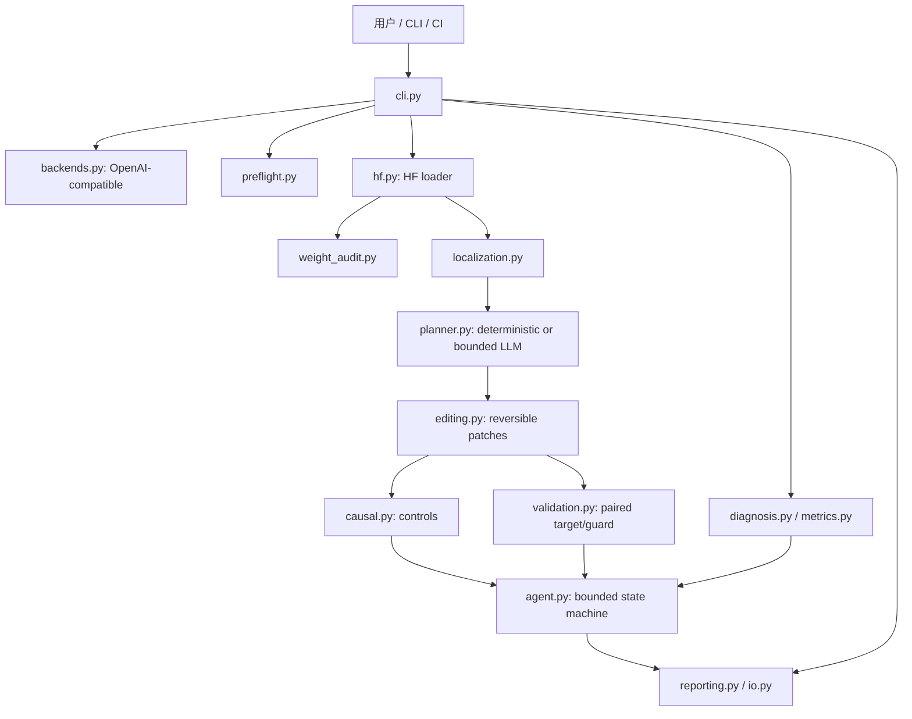
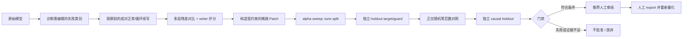

# WeightSpace Doctor · 工程架构与实现设计

## 0. 目标、非目标与证据等级

**目标**：把“发现模型输出异常、定位可能涉及的内部方向、提出安全且可回滚的修复、证明修复的收益”组织成可复用的 CLI、纯函数库、数据契约和独立评测。

**非目标**：仅扫描一个 `.safetensors` 文件就解释一个大模型全部知识；通用无损模型治疗；在没有输入/输出和对照样本时判断真实后门；用 LLM 的解释替代因果实验证据。

证据分级：

- **E0 现象**：`scan` 和 `probe` 返回重复、耗尽 token、JSON 无效、错误率等可观察症状。
- **E1 关联**：`localize` 提取层内残差方向，并且对特定 `down_proj` 写入列打分。此处不宣称找到了真正的神经“电路”。
- **E2 干预**：以 `causal` 在同一提示上下文下测量正常/异常续写概率；使用剂量反应、逐层隔离、随机正交等范数负对照。
- **E3 泛化**：独立、未参与选择的 target/guard 任务精度与行为指标；统计证据；经多个 seed 与不相关 Benchmark 重复。
- **E4 发布**：人工复核结果，安全检查，另存 BF16/FP16 checkpoint 后再量化和部署。项目不会代替这一步。

## 1. 模块分层（与文件一一对应）



面向职责的约束：

1. `schema.py` 只定义强类型的输入输出数据结构。
2. `metrics.py`、`diagnosis.py`、`validation.py` 尽量由纯函数构成；不依赖模型权重和远程 HTTP。
3. `backends.py`、`hf.py`、`editing.py` 分别隔离网络副作用、框架加载和内存中权重写入。
4. `localization.py` 中的 Hook 始终在 `finally` 中移除；只收集小型向量而不持久化完整模型激活。
5. `agent.py` 编排可解释的有界阶段，不接受自动执行的任意 Python 代码。
6. `reporting.py` 只根据真实输入指标渲染，不生成编造的模型成绩。

## 2. 两条独立工作流

### 2.1 热路径：无需权重的快速诊断

```text
API/MLX/现成输出日志
   │
   ├─ traces.jsonl ───► scan ──► diagnosis.json + report.md
   │
   ├─ 内置用例 ───────► quick (一条命令生成 cases 并 probe)
   │
   └─ cases.jsonl ────► probe (OpenAI ChatCompletion)
                               │
                               ▼
                         traces.jsonl
                               │
                               ▼
                              scan
```

适用：Mac MLX 4-bit、企业内部 OpenAI 兼容 API、各类远程闭源模型。**只分析行为，不推断神经元。**

症状与处置（条件是“样本中观察到”，而非模型本质诊断）：

| 指标 | 数据来源 | 可能原因 | 排查顺序 |
|---|---|---|---|
| `repetition_loop` | 输出尾部重复 8-gram 比例 | 生成循环、提示失配、采样问题 | 模板/采样 → 配对样本 → 权重定位 |
| `budget_exhaustion` | `finish_reason=length` | 输出窗口太短、EOS 故障、循环 | `max_tokens`/EOS → 是否重复 |
| `incorrect_or_format_failure` | 标准答案/正则 | 知识欠缺、任务定义或格式偏差 | 数据质量 → RAG/SFT 或约束解码 |
| `invalid_json` | tag=`json` + 严格 JSON 解析 | 缺格式约束、输出截断 | 约束解码/验证器，非优先改权重 |
| `possible_refusal` | tag=`benign` + 粗粒度短语匹配 | 安全策略、提示或模型行为 | 人工判断假阳性 |
| `request_error` | API/网络异常 | 服务不可用/权限/超时 | 先修推理基础设施 |
| `nonfinite_weights` | HF 权重读取 | NaN/Inf，潜在文件损坏 | 重新校验 checkpoint；禁止编辑 |

速度字段：`median_tokens_per_second = completion_tokens / 完整 HTTP 请求耗时`，**不是**框架纯粹的解码 tokens/s；同时包含 TTFT、排队、网络等开销。请不要直接与本地 MLX `generation_tps` 比较。

### 2.2 冷路径：有 BF16/FP16 权重和匹配对照时做修复



`repair` 优先进行原始模型的快速诊断，如未发现循环，不会进行后续编辑。该代理仅处理**循环行为的一个研究性编辑路径**，其他症状需用其他策略诊断，不能拿同一个编辑器“治疗”所有问题。

## 3. Patch 文件与事务语义

```text
candidate_patch/
  manifest.json     # model id, method, alpha, touched layers/columns,
                    # source tensor shapes/dtype/base sha256,
                    # before/after checksums, discovery case ids
  values.npz        # float32 copies of ORIGINAL and EDITED selected columns
```

- 校验单个张量的原始全量 SHA256 和所有要改的列的 checksum，再应用任何修改。
- 前后列在原始 dtype 下 round-trip，避免 FP16/BF16 意外的低精度误差。
- `temporary_patch` context manager 在成功及异常退出时尝试恢复被改动列。
- 多层 patch 采用**先预检所有层**，再逐层写入；中途写入错误时尝试回滚已写层。
- 当用户/其他线程并发写同一模型时无法保证事务隔离；本原型在**独占模型实例**上运行，不支持并发服务进程内热修改。
- `export` 只允许写入一个新的空目录，不覆写源 checkpoint。调用它不是表示已经通过生产审核。

## 4. 执行策略与资源边界

- `scan`/`probe` 不加载 HF 权重；只需 NumPy 和 Python 标准库，可以快速检查 MLX/4-bit 运行服务。
- `inspect` 仅读取 `config.json`、safetensors 索引和文件头，不加载全部 tensor。
- `weight-audit`/`localize`/`repair` 加载完整高精度模型。**BF16 权重约需 2 bytes/param**，27B 仅权重就约 54 GB（十进制），额外仍需模型缓存/激活/计算内存；64GB 机器通常不适合作为默认高精度编辑环境。请使用合适内存/GPU 服务器。
- `localize` 每个 contrast pair 需要 normal/bad 各一次前向，扫全层时由 Hook 收集各层末尾固定数量 token 的均值向量。每次 forward 的成本主要取决于模型规模和实际上下文长度。
- `repair` 每个 α 都运行一轮目标+保护用例，候选个数上限 8；不存在训练循环或梯度优化。
- 当前 Python HF Backend 按样本逐条生成，并没有并行 batching/多 GPU 优化；验证成本会随样本数和输出长度线性放大。
- 即便没有梯度，频繁前向验证仍然会消耗显著的计算时间；“快速”主要针对**先诊断/筛选，再按需进入昂贵的权重诊断**。

## 5. 后续可扩展接口

建议升级为 adapter/plugin 结构而不是把具体模型写死在 agent 中：

```python
from typing import Protocol

class InferenceAdapter(Protocol):
    def generate(self, case, *, max_new_tokens: int, temperature: float, seed: int): ...

class ActivationAdapter(Protocol):
    def capture(self, prompt: str, layers: list[int]): ...

class WeightAdapter(Protocol):
    def editable_modules(self): ...
    def read(self, module: str): ...
    def patch(self, patch): ...

class VerdictAdapter(Protocol):
    def score(self, case, trace): ...
```

未来 adapter：`HuggingFaceDense`（现状）、`HuggingFaceMoE`（需单独专家分配逻辑）、`MLXFloat`（未实现）、`RemoteBlackBox`（仅行为诊断）、`OpenAICompatible`（已具备基础行为生成）。

## 6. 核心工程验收标准

- A：离线只用 NumPy 运行 `demo → scan`，得到结构化报告。
- B：Mock HTTP server 能复现 `probe` 输出、接口异常与 `seed` 降级。
- C：小型随机权重模型完成捕捉激活、top-k 列排名、保存 patch、载入、应用、逐值恢复。
- D：被篡改的 patch / 不兼容 checkpoint 必须被拒绝；不得发生部分写入。
- E：输入样本不满足 split、置信度或 causal 条件时 `repair` 必须 abstain / not_approved。
- F：HF Qwen3.5-0.8B 实验必须先准备正确 chat template、理性采样参数、显存预算、完整目标/保护验证集，然后另行运行实模复现并公开真实日志；不能拿本项目的合成测试结果充数。
